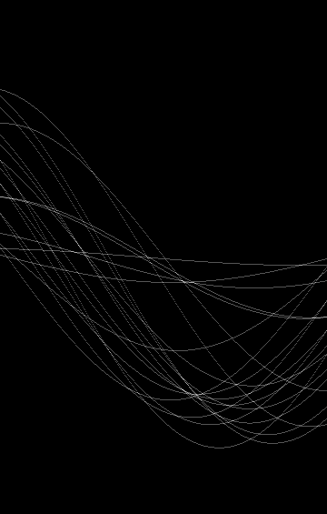
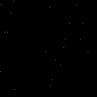
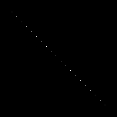
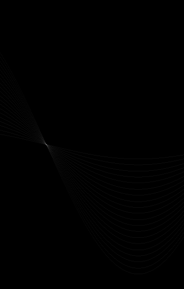
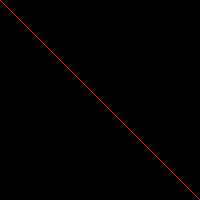
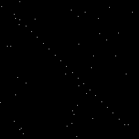
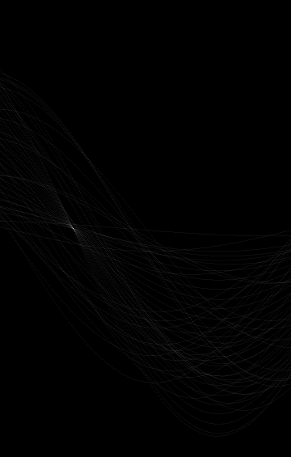
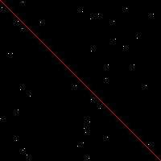
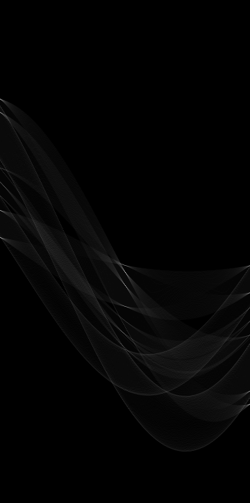
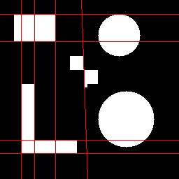

# Chapitre 5 — Transformée de Hough (droites)

Rédaction : Nkamla Chedjou Johan (22P607).

Les fonctions sont dans `imagerie::hough`. Les signatures prévues au départ
sont inchangées ; deux fonctions publiques ont été ajoutées :
`Accumulateur::theta(i)` / `Accumulateur::rho(j)` (paramètres d'une cellule) et
`image_points` (image de test de l'exemple du cours). Les figures sont dans
`figures/hough/` et se régénèrent avec `sh rapport/figures/hough/generer.sh`.

## Usage

```rust
use imagerie::hough;
use imagerie::Rvb;

let acc = hough::hough_droites(&contours, 1.0, 1.0);   // pas de 1° et de 1 pixel
let image_votes = acc.affichable();
let droites = acc.pics(5, 10);                          // 5 droites d'au moins 10 votes
let trace = hough::tracer_droites(&gris, &droites, Rvb::new(255, 0, 0));
```

En ligne de commande :

```sh
# image de test : 20 points alignés (+ 40 points aléatoires)
cargo run --release -- hough points points.pgm --alignes 20 --aleatoires 40
cargo run --release -- hough accumulateur points.pgm votes.pgm --pas-theta 0.5
cargo run --release -- hough pics points.pgm -n 3 --votes-min 8
cargo run --release -- hough droites points.pgm droites.ppm -n 1 --votes-min 8
# image quelconque : contour des objets après un seuillage d'Otsu
cargo run --release -- hough droites images/formes.pgm droites.ppm --contours -n 8 --votes-min 30
```

Par défaut, les pixels >= 128 de l'image d'entrée sont les points de contour.
Avec `--contours`, l'image est seuillée par Otsu (`segmentation::seuil_otsu`)
puis on garde le contour intérieur des objets
(`morphologie::gradient_interne` avec la croix). C'est une solution d'attente :
le cours applique Hough sur la sortie d'un détecteur de contours (Sobel,
Canny…), et `contours.rs` (Pio) n'est pas encore écrit sur `main`. Quand il le
sera, on pourra brancher `contours::contours_gradient` à la place.

## 1. Principe

La transformée de Hough est une approche **globale** : au lieu de décider
pixel par pixel s'il y a un contour, on cherche les droites complètes qui
passent par le plus grand nombre de points de contour.

Dans le plan (a, b), un point (xi, yi) correspond à la droite
b = −xi a + yi ; tous les points d'une même droite y = a' x + b' du plan image
donnent des droites qui se coupent en (a', b'). On découpe le plan des
paramètres en **cellules d'accumulation** ; chaque point vote pour toutes les
cellules qu'il traverse, et les cellules qui reçoivent le plus de votes sont
les droites de l'image.

## 2. Formule du cours

Problème du plan (a, b) : pour une droite verticale, a et b sont infinis.
Le cours utilise donc la forme polaire

ρ = x cos θ + y sin θ, avec θ ∈ [−90°, 90°[ et ρ ∈ [−D, D],

où D est la diagonale de l'image. Un point de l'image devient une sinusoïde
dans le plan (θ, ρ) ; des points alignés donnent des sinusoïdes qui se coupent
toutes au même point (θ, ρ) de la droite.

## 3. Implémentation

- **Repère.** x est la colonne, y la ligne (vers le bas), origine en haut à
  gauche, comme dans tout le projet. Une droite verticale x = c a θ = 0 et
  ρ = c ; une droite horizontale y = c a θ = −90° et ρ = −c ; la diagonale
  y = x a θ = −45° et ρ = 0.
- **Accumulateur** (`hough_droites`). Matrice `Image<u32>` : colonne i ↔
  θi = −90° + i·pas_θ (180 / pas_θ colonnes), ligne j ↔ ρj = (j − (H − 1)/2)·pas_ρ,
  avec D = √((l − 1)² + (h − 1)²) et H = 2⌈D / pas_ρ⌉ + 1 lignes. cos θ et
  sin θ sont précalculés ; pour chaque pixel de contour et chaque θ, on calcule
  ρ et on arrondit à la cellule la plus proche. Coût O(nb_points × nb_θ).
  `pas_theta` est stocké en radians dans `Accumulateur`.
- **Paramètres invalides.** La signature de `hough_droites` ne renvoie pas de
  `Resultat` et elle est partagée : un pas non fini ou <= 0 est remplacé par
  1 (1° ou 1 pixel) au lieu de paniquer, et un pas < 0,01 est ramené à 0,01. La
  ligne de commande refuse ces valeurs avec une `Erreur::Parametre`.
- **Recherche des pics** (`Accumulateur::pics`).
  1. On garde les maxima locaux (cellule >= ses 8 voisines) qui ont au moins
     `votes_min` votes. θ est périodique : à gauche de −90° on retrouve
     +90° − pas avec ρ opposé, le voisinage en tient compte.
  2. On les trie par votes décroissants, puis par somme des votes 3 × 3.
  3. Une droite courte vote autant pour plusieurs θ voisins (dans une petite
     image, x cos θ + y sin θ arrondi ne change pas pour θ ± 1°) : on prend le θ
     du **milieu du plateau** de cellules égales.
  4. Un pic à moins de 5° **et** 5 pixels d'un pic déjà retenu est écarté (même
     droite), ainsi que sa version repliée (θ ± 180°, −ρ).
- **Image de l'accumulateur** (`affichable`) : votes × 255 / max, arrondis.
- **Tracé** (`tracer_droites`) : l'image est passée en RVB ; pour une droite
  plutôt horizontale (|sin θ| >= |cos θ|) on calcule y pour chaque colonne,
  sinon x pour chaque ligne, ce qui donne un tracé continu sans trou.
- **Image de test** (`image_points`) : `nb_alignes` points régulièrement
  espacés sur la diagonale de (10 %, 10 %) à (90 %, 90 %), plus `nb_aleatoires`
  points tirés avec `alea::Alea` (graine fixe).

## 4. Résultats

### Exemple du cours : points aléatoires contre points alignés

Images 200 × 200 ; accumulateurs avec un pas de 0,5° (360 colonnes, θ de −90° à
gauche à +90° à droite) et de 1 pixel (565 lignes, ρ de −282 en haut à +282 en
bas).

| | points | accumulateur | droite détectée |
|---|---|---|---|
| 20 points aléatoires |  |  |  |
| 20 points alignés |  |  |  |
| 20 alignés + 40 aléatoires |  |  |  |

On retrouve les diapositives 38 et 39 du cours :

- **points aléatoires** : chaque point donne sa sinusoïde, elles se croisent
  deux à deux un peu partout mais jamais en grand nombre au même endroit
  (maximum 3 votes). Avec `--votes-min 8`, aucune droite n'est détectée : « la
  transformée de points aléatoires ne donne rien de précis » ;
- **points alignés** : les 20 sinusoïdes passent toutes par la même cellule,
  bien visible dans l'accumulateur ; le pic a 20 votes en θ = −45°, ρ = 0,
  c'est-à-dire la droite y = x, tracée en rouge ;
- **points alignés + bruit** : 40 points aléatoires ajoutent des sinusoïdes
  mais le pic de 20 votes reste nettement au-dessus (le bruit ne dépasse pas
  quelques votes) : la droite est retrouvée sans erreur. C'est l'intérêt d'une
  méthode globale par vote.

### Image de formes

`formes.pgm` → contour intérieur après Otsu (1 104 points) → accumulateur
(pas 0,5°) et 8 droites d'au moins 30 votes.

| accumulateur | droites détectées |
|---|---|
|  |  |

| ρ | θ | votes | droite de l'image |
|---|---|---|---|
| 30 | 0° | 102 | x = 30 : bord gauche du L (y = 115 à 219) |
| 49 | 0° | 83 | x = 49 : bord droit de la barre verticale du L |
| −219 | −90° | 80 | y = 219 : bas du L |
| −200 | −90° | 63 | y = 200 : haut de la barre horizontale du L |
| −59 | −90° | 62 | y = 59 : bas du rectangle (x = 20 à 79) |
| −20 | −90° | 61 | y = 20 : haut du rectangle |
| 116 | −2° | 44 | droite presque verticale : bord droit du 1er petit carré (x = 119) et bord gauche du 2e (x = 120) |
| 79 | 0° | 42 | x = 79 : bord droit du rectangle |

Les droites trouvées sont les côtés rectilignes du rectangle et du L, par
ordre de longueur. Une droite est infinie, pas un segment : le trait rouge
traverse toute l'image, par exemple x = 30 (bord du L) coupe aussi le
rectangle. Le bord gauche du rectangle (x = 20, 40 votes) n'apparaît pas
seulement parce qu'on a limité la recherche à 8 droites. Les deux petits carrés décalés produisent une droite
légèrement inclinée (−2°) qui s'appuie sur un bord de chacun : elle reçoit
assez de votes parce que leurs bords sont presque alignés. Les disques ne
produisent pas de pic : leurs points votent pour des droites toutes
différentes.

## 5. Limites observées

- Le résultat dépend du pas de discrétisation : un pas fin sépare mieux les
  droites proches mais disperse les votes d'une droite légèrement bruitée ; un
  pas grossier fait l'inverse.
- Le choix de `votes_min` et du nombre de droites est empirique : il faut
  connaître à peu près la longueur des segments recherchés.
- La transformée donne des droites infinies ; pour obtenir des segments il
  faudrait chercher, le long de chaque droite, les intervalles couverts par des
  points de contour.
- Coût proportionnel à nombre de points × nombre d'angles : il faut une image
  de contours fins (un pixel d'épaisseur), d'où l'intérêt de la suppression des
  non-maxima du chapitre 5 quand elle sera disponible.
- Tant que `contours.rs` n'est pas écrit, l'entrée est soit une image de points,
  soit le contour d'un seuillage d'Otsu, ce qui ne marche que sur des images
  bien contrastées.

Découpage possible en demandes de fusion : la transformée de Hough
(`imagerie/src/hough.rs`, `imagerie-cli/src/commandes/hough.rs`,
`rapport/hough.md`) est indépendante de la segmentation et peut faire l'objet
d'une demande séparée (branche `johan/hough`).
