# Chapitre 6 — Segmentation

Rédaction : Nkamla Chedjou Johan (22P607).

Les fonctions sont dans `imagerie::segmentation`. Les signatures prévues au
départ sont inchangées. Les figures sont dans `figures/segmentation/` (PGM/PPM
et copie PNG) et se régénèrent avec `sh rapport/figures/segmentation/generer.sh`.

## Usage

```rust
use imagerie::segmentation::{self, Homogeneite};
use imagerie::Connexite;

let t = segmentation::seuil_otsu(&gris);
let binaire = segmentation::seuillage(&gris, t);
let classes = segmentation::seuillage_multiple(&gris, &[60, 180])?;   // 3 classes
let local = segmentation::seuillage_adaptatif(&gris, 32, 100.0)?;
let km = segmentation::kmoyennes_couleur(&rvb, 4, 100, 1)?;
let poster = segmentation::image_kmoyennes_couleur(&km);
let regions = segmentation::division_fusion(&gris, Homogeneite::MaxMin(20), 4)?;
let germes = segmentation::germes_automatiques(&gris, 40);
let regions = segmentation::croissance_regions(&gris, &germes, 15.0, Connexite::Quatre)?;
```

En ligne de commande (une sous-commande par fonction) :

```sh
cargo run --release -- segmentation seuil images/mire.pgm sortie.pgm 128
cargo run --release -- segmentation multiple images/mire.pgm sortie.pgm 60 180
cargo run --release -- segmentation moyenne|milieu|mediane|otsu|kittler images/mire.pgm sortie.pgm
cargo run --release -- segmentation adaptatif images/mire.pgm sortie.pgm --bloc 32 --variance-min 100
cargo run --release -- segmentation kmoyennes images/mire.pgm sortie.pgm -k 3
cargo run --release -- segmentation kmoyennes-couleur images/couleur.ppm sortie.ppm -k 4
cargo run --release -- segmentation division images/mire.pgm blocs.ppm --critere max-min --valeur 20 --taille-min 4
cargo run --release -- segmentation division-fusion images/mire.pgm regions.ppm --critere variance --valeur 100
cargo run --release -- segmentation croissance images/mire.pgm regions.ppm --germe 70,70 --germe 175,80 -t 20
cargo run --release -- segmentation croissance images/mire.pgm regions.ppm --espacement 40   # germes automatiques
cargo run --release -- segmentation germes images/mire.pgm germes.ppm --espacement 40
```

Les seuillages automatiques affichent le seuil trouvé. Les étiquettes
(division-fusion, croissance) sont enregistrées avec une couleur par région
(`ImageEtiquettes::vers_couleurs`), le fond (0) en noir.

## Convention commune

- Un pixel est objet (1, blanc) si f(x, y) >= T, fond (0) sinon, comme dans le
  cours. La classe 1 d'un seuil T est donc [0, T − 1], la classe 2 [T, 255].
- Quand plusieurs seuils sont également bons (Otsu, Kittler, médiane), on prend
  le **milieu du palier** de valeurs optimales et non le premier. Pour une image
  à deux niveaux 50 et 200, tous les T de 51 à 200 annulent la variance
  intra-classes : on renvoie 125, au milieu du creux de l'histogramme.
- Les fonctions dont la signature renvoie `Resultat` refusent les paramètres
  invalides (`Erreur::Parametre`) au lieu de paniquer : seuils non croissants,
  bloc de taille 0, variance ou tolérance négative, k = 0, plus de groupes que
  de valeurs distinctes, germe hors de l'image… Les fonctions qui renvoient
  directement un seuil (`seuil_*`) renvoient 0 pour une image vide.

---

## 1. Seuillage simple et multiple

**Principe.** Le seuillage est une opération sur les pixels : chaque pixel est
classé d'après son seul niveau de gris, sans tenir compte de ses voisins.

**Formule du cours.**

- simple : g(x, y) = 1 si f(x, y) >= T, 0 sinon ;
- multiple : n seuils T1 < … < Tn donnent n + 1 classes,
  g = 0 si f < T1, g = i si Ti <= f < Ti+1, g = n si f >= Tn.

**Implémentation.** `seuillage` est un simple `map`. `seuillage_multiple`
vérifie que la liste n'est pas vide et strictement croissante, construit une
table de 256 entrées (classe de chaque niveau = nombre de seuils atteints) puis
l'applique : coût O(256 n + MN).

**Résultats.**

| T = 128 | 2 seuils (60, 180) : 3 classes |
|---|---|
| 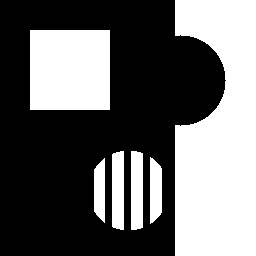 | 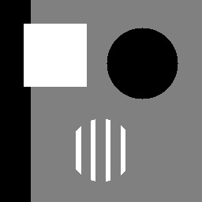 |

Avec T = 128, le carré clair et les bandes claires du disque rayé sont des
objets, mais toute la moitié droite du fond (rampe qui va d'environ 30 à 170)
l'est aussi : un seuil global ne sait pas gérer un éclairage non uniforme.
Avec deux seuils, on obtient trois classes : le disque sombre et le bord gauche
(classe 0, noir), le fond (classe 1, gris) et le carré (classe 2, blanc).

## 2. Choix du seuil : moyenne, milieu, médiane

**Formules du cours** (« comment trouver le bon seuil ? ») :

- `seuil_moyenne` : T = moyenne des niveaux, arrondie ;
- `seuil_milieu` : T = (min + max) / 2, arrondi (« valeur médiane entre le ton
  maximum et le ton minimum ») ;
- `seuil_median` : la valeur « qui balance les deux sections de
  l'histogramme ». On cherche le T qui minimise |#{f < T} − #{f >= T}| ; c'est
  la médiane des pixels. Pour [10, 20, 30] on obtient 20, pour [10, 20, 30, 240]
  tous les T de 21 à 30 coupent 2 / 2 et on renvoie le milieu, 25.

**Résultats sur `mire.pgm`.**

| moyenne (T = 111) | milieu (T = 120) | médiane (T = 108) |
|---|---|---|
| 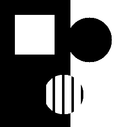 | 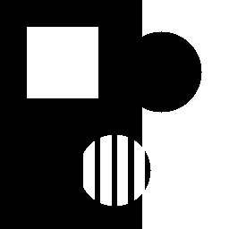 | 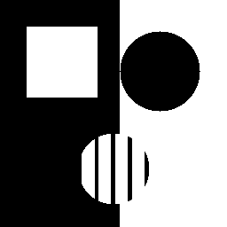 |

Les trois seuils sont proches (108 à 120) parce que le fond occupe la plus grande
partie de l'image. Ils donnent tous le même défaut : la frontière verticale au
milieu du fond se déplace avec T mais ne disparaît jamais.

## 3. Otsu et Kittler

**Otsu (formule du cours).** On balaie tous les seuils T ; pour chacun on
calcule les proportions P1, P2, les moyennes μ1, μ2 et les variances σ1², σ2²
des deux classes, puis la variance intra-classes

σw²(T) = P1 σ1² + P2 σ2², avec P1 = (1 / NM) Σ_{i<T} h(i), P2 = 1 − P1.

Le seuil optimal est celui qui donne σw² minimal.

*Remarque sur la diapositive.* Lue à la lettre, la diapositive écrit
μ1 = (1/T) Σ h(i) et σ1² = (1/T) Σ (h(i) − μ1)², c'est-à-dire la moyenne et la
dispersion des **effectifs** h(i) de l'histogramme. Ce n'est pas la méthode
d'Otsu : les moyennes et variances doivent porter sur les **niveaux de gris**,
pondérés par leur effectif. Nous utilisons donc
μ1 = Σ_{i<T} i h(i) / Σ_{i<T} h(i) et σ1² = Σ_{i<T} (i − μ1)² h(i) / Σ_{i<T} h(i)
(idem pour la classe 2), qui est la définition d'Otsu et qui donne bien le
seuil du creux entre les deux modes (T = 125 pour l'image 50 / 200 des tests).

**Kittler (bonus).** Méthode de l'erreur minimale : on modélise chaque classe
par une gaussienne (P, μ, σ) et on minimise

J(T) = 1 + 2 [P1 ln σ1 + P2 ln σ2] − 2 [P1 ln P1 + P2 ln P2].

Un T pour lequel une classe est vide ou de variance nulle n'est pas évalué ; si
aucun T n'est évaluable (image à un ou deux niveaux), on renvoie le seuil
d'Otsu.

**Implémentation.** Les deux méthodes travaillent sur l'histogramme : pour
chaque T, on cumule n, Σ i h(i) et Σ i² h(i) des deux classes. Coût O(256²),
indépendant de la taille de l'image. On ne considère que T dans [1, 255] avec
deux classes non vides. Une image constante renvoie son unique niveau.

**Dépendance.** Le cours et `TACHES.md` prévoient d'utiliser
`ponctuel::histogramme` (Jeff). Les seuils calculés sur l'image entière
(`seuil_median`, `seuil_otsu`, `seuil_kittler`, `kmoyennes_gris`, et le
seuil global de `seuillage_adaptatif`) appellent cette fonction, qui
renvoie un `[u32; 256]`. Pour les blocs du seuillage adaptatif, qui ne
sont pas une `ImageGris` complète, l'histogramme est calculé par une
petite fonction interne `histogramme_pixels`.

**Résultats.**

| Otsu sur `mire` (T = 114) | Otsu sur `sombre` (T = 117) | Kittler sur `mire` (T = 209) |
|---|---|---|
| 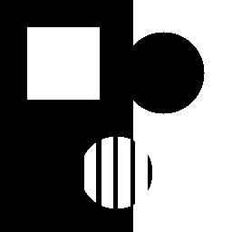 |  | 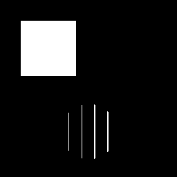 |

Otsu sépare correctement le carré clair et le disque sombre, mais coupe le fond
en deux à cause de la rampe d'éclairage, comme dans l'exemple « seuillage global
— problème » du cours. Sur `sombre.pgm` (même scène, contraste réduit) le
résultat est le même : Otsu ne dépend que de la forme de l'histogramme, pas de
sa dynamique. Kittler place le seuil beaucoup plus haut (209) : l'histogramme
de `mire` n'est pas un mélange de deux gaussiennes (la rampe donne un plateau),
le modèle de Kittler est faux et il isole seulement les pixels les plus clairs
(carré et sommets des bandes). Comme le dit le cours : chaque méthode donne un
seuil différent, il faut tester pour chaque application.

## 4. Seuillage local adaptatif

**Principe (cours, exemple de Gonzalez et Woods).** On découpe l'image en
sous-images et on seuille chacune avec son propre seuil. Avant de traiter une
sous-image, on regarde la variance de ses niveaux de gris : si elle est
inférieure à 100, le bloc ne contient pas de frontière et n'est pas seuillé.

**Implémentation.** Blocs de `taille_bloc` × `taille_bloc` (les blocs du bord
droit et du bas peuvent être plus petits). Pour chaque bloc :

- variance >= `variance_min` : seuil d'Otsu du bloc, calculé sur son
  histogramme ;
- variance < `variance_min` : le bloc entier est objet si sa moyenne est >= au
  seuil d'Otsu global, fond sinon (règle fixée dans la documentation de la
  fonction).

**Résultats.**

| blocs 32 × 32, variance < 100 non traitée | blocs 32 × 32, tous traités |
|---|---|
| 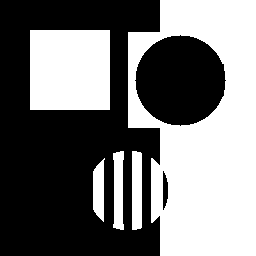 | 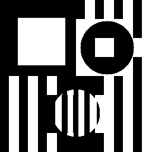 |

Sans le test de variance (à droite), chaque bloc de fond est coupé en deux par
son propre Otsu et on voit apparaître des bandes dans la rampe : c'est
exactement pourquoi le cours ne traite pas les blocs de faible variance. Avec le
test (à gauche), les blocs uniformes sont pris en entier ; le contour du disque
rayé et celui du carré sont obtenus avec le seuil local de leur bloc.

## 5. k-moyennes sur l'intensité et sur la couleur

**Algorithme du cours (4 étapes).** 1. partition initiale en k groupes non vides ;
2. calcul des centres (moyenne des pixels du groupe) ; 3. chaque pixel est
affecté au groupe dont le centre est le plus proche ; 4. retour à l'étape 2.
Arrêt quand les groupes ne changent plus.

**Implémentation.**

- Initialisation (étape 1) : au lieu d'une partition au hasard, on choisit k
  centres parmi les valeurs **distinctes** de l'image par la méthode
  « k-means++ » : le premier au hasard (proportionnellement au nombre de
  pixels), chaque suivant avec une probabilité proportionnelle à
  effectif × D², où D est la distance au centre le plus proche déjà choisi. Le
  tirage utilise `alea::Alea` et la `graine` donnée (résultats reproductibles).
  Avec un simple tirage uniforme des valeurs distinctes, nous obtenions sur
  `couleur.ppm` un mauvais minimum local : le fond en dégradé fournit presque
  toutes les couleurs distinctes, trois centres partaient dans le fond et le
  rouge et le vert finissaient dans le même groupe (centre brun
  (147, 96, 48)). Si l'image a moins de k valeurs distinctes, on renvoie une
  erreur.
- Intensité : tous les pixels d'un même niveau vont dans le même groupe, on
  travaille donc sur les 256 cases de l'histogramme au lieu des MN pixels
  (une itération coûte O(256 k)).
- Couleur : distance euclidienne dans RVB, une itération coûte O(MN k).
- Un groupe qui se vide garde son ancien centre. On s'arrête quand plus aucune
  affectation ne change ou après `iterations_max` itérations (le nombre
  d'itérations est renvoyé).
- Les groupes sont renumérotés du plus sombre au plus clair (luminance
  0,299 R + 0,587 V + 0,114 B en couleur) : l'étiquette 1 est toujours le
  groupe le plus sombre, quelle que soit la graine.
- `image_kmoyennes_couleur` remplace chaque pixel par le centre de son groupe.

**Résultats.**

| `mire`, k = 3 sur l'intensité | `couleur`, k = 4 sur l'intensité | `couleur`, k = 4 sur la couleur |
|---|---|---|
| 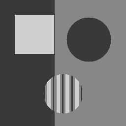 | 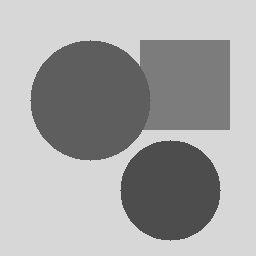 | 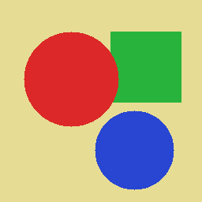 |

Sur `mire`, les trois centres (57, 135, 207) donnent la moitié gauche du fond
avec le disque sombre, la moitié droite du fond, et le carré : les k-moyennes,
comme le seuillage, ignorent la position des pixels et coupent le dégradé.
La comparaison intensité / couleur reprend l'exemple du cours (Forsyth et
Ponce). Sur l'intensité (image convertie en luminance), les quatre groupes ont
pour centres 77, 94, 124 et 215 : les trois formes sont séparées, mais
seulement par des niveaux de gris voisins (le disque rouge et le disque bleu
ne diffèrent que de 17 niveaux), et deux couleurs différentes de même
luminance seraient confondues. Sur la couleur, les quatre centres trouvés sont
exactement les couleurs des objets — bleu (40, 70, 210), rouge (220, 40, 40),
vert (40, 180, 60) — et le fond (230, 220, 147), en 2 itérations : l'image
« posterisée » est presque identique à l'originale, sans le dégradé du fond.

## 6. Division-fusion (split and merge)

**Principe du cours.** Phase 1 (division) : l'image est la racine d'un arbre ;
toute feuille non homogène est divisée en 4 sous-blocs (quadtree), jusqu'à ce
que toutes les feuilles soient homogènes. Phase 2 (fusion) : on regroupe les
blocs adjacents dont l'union reste homogène. Prédicat : variance ou max − min.

**Implémentation.**

- `Homogeneite::Variance(v)` : variance <= v ; `Homogeneite::MaxMin(m)` :
  max − min <= m.
- `division` : parcours en profondeur avec une pile. Un bloc non homogène n'est
  divisé que si ses quatre sous-blocs gardent au moins `taille_min` pixels de
  côté (les tailles impaires sont coupées en ⌊l/2⌋ et l − ⌊l/2⌋). La fonction
  renvoie la liste des feuilles (x, y, largeur, hauteur).
- `division_fusion` : chaque région garde des statistiques cumulables
  (n, Σf, Σf², min, max), si bien que l'homogénéité de l'union de deux régions
  se calcule en O(1). Les paires de blocs adjacents (4-connexité) sont triées
  par écart de moyenne croissant pour fusionner d'abord les plus semblables ;
  les fusions utilisent une structure union-find, et on repasse sur toutes les
  paires jusqu'à ce qu'aucune fusion ne soit plus possible. Les régions sont
  numérotées 1..n dans l'ordre du balayage ligne par ligne.

**Résultats.**

| division (max − min <= 20, blocs >= 4) | fusion | fusion sur `couleur` (variance <= 50) |
|---|---|---|
| 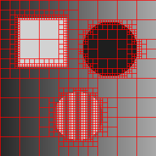 | 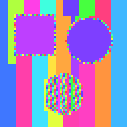 | 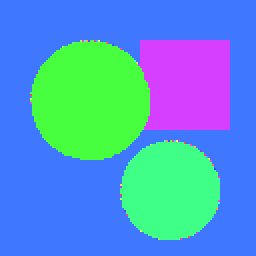 |

La division (907 blocs) montre bien le quadtree : grands blocs dans les zones
uniformes, blocs de 4 × 4 le long des contours et dans le disque rayé. Après
fusion il reste 442 régions sur `mire` : le carré et le disque sont chacun une
région, mais la rampe du fond est découpée en bandes verticales (une région ne
peut pas couvrir plus de 20 niveaux) et les blocs 4 × 4 mixtes des bords et des
rayures restent des petites régions. Sur l'image `couleur` (convertie en gris),
la fusion retrouve le fond, les deux disques et le carré (71 régions, dont la
plupart sont des blocs de bord de quelques pixels).

## 7. Croissance de régions

**Principe du cours.** On part d'un germe et on ajoute les pixels voisins qui
satisfont un critère d'homogénéité. Le germe est choisi par un humain ou
automatiquement, « en évitant les zones de fort contraste (gradient
important) ». Avec plusieurs germes, plusieurs régions grandissent.

**Implémentation.**

- Critère : un voisin v est ajouté à la région R si |f(v) − moyenne(R)| <=
  tolérance ; la moyenne est mise à jour à chaque ajout (critère dynamique).
- Voisinage N4 ou N8 (`Connexite`).
- Tous les germes partagent une même file (parcours en largeur) : les régions
  grandissent en même temps, et un pixel appartient à la première région qui
  l'atteint. Germe i → étiquette i + 1 ; un germe déjà pris (germe en double)
  ne crée pas de région ; les pixels jamais atteints restent à 0.
- `germes_automatiques` : norme du gradient de Sobel |Gx| + |Gy| (bord
  répliqué), calculée avec `contours::gradient` (Pio) et
  `Gradient::norme_approchee`, minima locaux (pixel <= ses 8 voisins), triés
  par gradient croissant ; un minimum est retenu s'il est à au moins
  `espacement` pixels (distance max(|dx|, |dy|)) de tous les germes déjà
  retenus. Dans une zone plate, tout pixel est un minimum : on obtient une
  grille de germes espacés.

**Résultats.**

| 1 germe (70, 70), tolérance 20 | 4 germes | germes automatiques | croissance depuis ces germes |
|---|---|---|---|
| 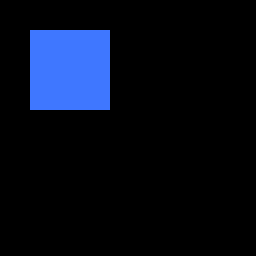 | 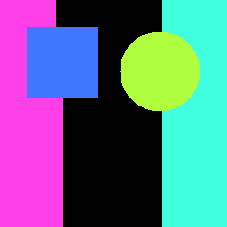 | 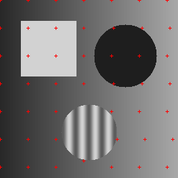 | 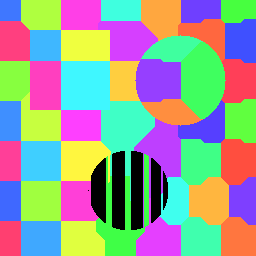 |

Un germe dans le carré donne exactement le carré. Avec quatre germes (carré,
disque sombre, coin haut-gauche, coin bas-droit), on obtient quatre régions ;
la rampe du fond n'est couverte qu'en partie car la moyenne de la région
s'éloigne des pixels de plus en plus clairs. Les 47 germes automatiques évitent
les contours (aucun sur le bord du carré ou du disque) ; la croissance qui suit
donne une sur-segmentation du fond en 47 régions, avec 3 430 pixels non classés
(surtout dans les rayures, où le gradient est fort partout).

## Limites observées

- Toutes les méthodes par seuil (global, moyenne, médiane, Otsu, Kittler,
  k-moyennes sur l'intensité) ignorent la position des pixels : elles ne
  peuvent pas traiter un fond en dégradé comme celui de `mire`.
- Seuillage adaptatif : les blocs uniformes sont classés d'après le seuil
  global ; sous un éclairage très variable un bloc de fond clair peut être pris
  pour un objet. Le résultat dépend fortement de la taille des blocs.
- Kittler suppose deux classes gaussiennes ; sur des histogrammes très
  différents (plateau, mode unique) le seuil n'a pas de sens.
- k-moyennes : k est imposé, le résultat dépend de l'initialisation (d'où la
  graine et le choix k-means++) et un dégradé « consomme » des groupes.
- Division-fusion et croissance : beaucoup de paramètres (critère, seuil,
  taille minimale, tolérance, espacement) ; un dégradé est sur-segmenté et les
  textures fines (disque rayé) donnent une multitude de petites régions. Un
  post-traitement (suppression des petites régions avec `binaire`) serait
  nécessaire.
- Comme le rappelle le cours, aucune méthode ne marche pour toutes les images :
  il faut choisir et régler selon l'application.
